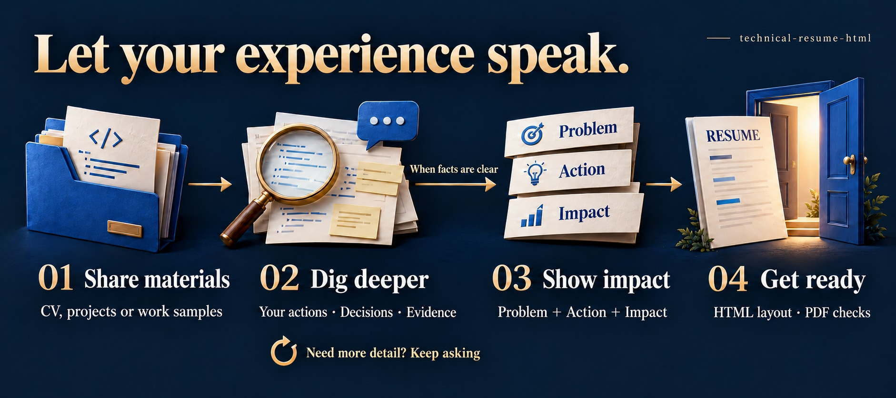

<p align="center">
  
</p>

<h1 align="center">Let your work open new doors</h1>

<p align="center">
  Job search · Career changes · Internal promotions · Professional growth · Codex Skill<br>
  <strong>Start with your resume or work samples. Explore your real contribution, then connect it to your next opportunity.</strong>
</p>

<p align="center">
  <a href="README.md">简体中文</a> · <strong>English</strong>
</p>

<p align="center">
  <a href="#start">Get started</a> ·
  <a href="#example">See an example</a> ·
  <a href="#workflow">How the interview works</a> ·
  <a href="#preview">Preview the output</a>
</p>

Whether you are applying for your first internship, changing employers, moving into a new field, pursuing an internal promotion or presenting freelance work, you need to explain what your experience means. Daily tasks, customer work, team coordination and project delivery often end up reduced to “responsible for…” on a resume.

**technical-resume-html helps people across roles and career stages explain their real contribution.** It reads your existing resume, work samples, project notes or code, then asks follow-up questions about your actions, decisions and results. Those facts become experience entries that a hiring manager, team or promotion panel can understand and discuss.

Use it for engineering, product, operations, marketing, sales, design, business support, management and other roles. The original skill name is retained for existing installations; the questions and document structure adapt to your background. Bring one useful source to start, even if you are unsure what your strongest achievement is.

<a id="example"></a>

## Make the value of an experience easier to understand

This fictional cross-functional example illustrates the writing structure. Your own actions, outcomes and evidence must be established before they are used.

> Responsible for project communication and handovers.

Expanded using **Problem + Solution + Improved efficiency / demonstrated impact** (`问题＋解决＋提升效率`):

> Addressed incomplete cross-team handovers by creating a delivery checklist and clarifying owners, acceptance milestones and escalation paths, enabling receiving teams to check work against consistent criteria and reducing clarification caused by missing information.

| What the reader needs to understand | What the entry explains |
| --- | --- |
| What problem did you face? | Incomplete handovers led to repeated clarification. |
| What did you do? | Defined a checklist, owners, acceptance milestones and escalation paths. |
| What improved? | Receiving teams could check work consistently, with fewer omissions and clarification loops. |

The solution may be a technical mechanism, business method, research decision, process change, coordination approach or customer strategy. Impact may mean less time or cost, better delivery, progress toward business goals, lower risk or improved customer experience. Use measured results when available, with their scope; otherwise establish a supported qualitative outcome rather than inventing a percentage.

The original technical example and further role-specific guidance are in the [three-part writing reference](references/problem-solution-efficiency.md) (Chinese).

<a id="workflow"></a>

## From source material to experience you can explain



**Missing important facts? Keep asking. Write once the relevant facts are clear.** The [full workflow definition](docs/workflow.mmd) is also available.

If you say “I improved our handover process,” it asks where clarification used to happen, which changes you drove, who was involved, what steps or omissions were reduced and what records show the difference. For a technical role, it can then ask about implementation, tests and deployment.

**Each round usually focuses on 3–5 high-value questions, with no fixed total number of rounds.** Facts already established are not requested again. If an important entry is missing the problem, solution or demonstrated improvement, the interview continues. You can also ask for an early draft based only on known facts.

| Your situation | A useful starting point |
| --- | --- |
| First job, graduate application or internship | Explore supported contributions from study, practice, volunteering, projects or internships. |
| Experienced hire or return to work | Reorganize work outcomes around the target role and current capabilities. |
| Career or industry change | Identify transferable methods, collaboration skills and results relevant to the new role. |
| Promotion or internal selection | Explore decisions, business responsibility, team influence and ownership of outcomes. |
| Freelance or consulting work | Explain client needs, service boundaries, deliverables and acceptance criteria. |
| Different professional functions | Adapt questions and evidence to the role; a code repository is optional. |

<a id="start"></a>

## Get started

This is a **Skill for an AI coding agent**, containing interview and writing instructions, an HTML template and a browser-based layout checker. It runs through an agent that supports skills; it is not a standalone recruitment website.

### 1. Install in Codex

Download or clone the repository:

```bash
git clone https://github.com/kayaduster607-jpg/technical-resume-html.git
cd technical-resume-html
```

Place the complete directory containing `SKILL.md`, named `technical-resume-html`, in one of these locations:

| Scope | Location |
| --- | --- |
| Available across your projects | `~/.agents/skills/technical-resume-html/` |
| Available in a single project | `<project-root>/.agents/skills/technical-resume-html/` |

These locations and explicit invocation follow the [official OpenAI documentation](https://learn.chatgpt.com/docs/build-skills). If the installed skill does not appear, restart Codex. Compare existing installations before adding another copy with the same name.

<details>
<summary>Windows installation from the downloaded repository root</summary>

Open PowerShell in the directory containing `SKILL.md`, then run:

```powershell
# Check the source to avoid installing an unrelated directory.
$resumeSkillSource = (Get-Location).Path
if (-not (Test-Path -LiteralPath (Join-Path $resumeSkillSource 'SKILL.md'))) {
    throw 'Open the repository directory containing SKILL.md first.'
}

# Keep any existing installation until its contents have been compared.
$resumeSkillsRoot = Join-Path $env:USERPROFILE '.agents\skills'
$resumeSkillTarget = Join-Path $resumeSkillsRoot 'technical-resume-html'
if (Test-Path -LiteralPath $resumeSkillTarget) {
    throw 'A skill with this name already exists. Compare versions first.'
}
New-Item -ItemType Directory -Path $resumeSkillsRoot -Force | Out-Null
Copy-Item -LiteralPath $resumeSkillSource -Destination $resumeSkillTarget -Recurse
```

</details>

### 2. Share one useful source

Select the skill in Codex or enter:

```text
Use $technical-resume-html to prepare a resume for my next career opportunity.

Target role or purpose: [job application, career change, internal promotion, etc.]
My current resume, work samples or project material: [attach, paste or provide a path]
Preferred output language: English.

Read the material first. Ask follow-up questions until the key facts are clear.
Write each important experience point as problem + solution + improved efficiency
or demonstrated impact. Make my own contribution, decisions and evidence clear.
```

A current resume, work summary, project material, performance review or code repository is enough to begin. Include a target role or job description if available.

The main skill instructions, supporting references and starter template are currently written primarily in Chinese. The agent is instructed to follow the requested output language and adapt labels and wording; this English README is not a claim that every bundled example has been translated.

### 3. Answer questions, then prepare your materials

Before writing, the workflow separates supported facts, inferences that need confirmation and unsupported assumptions. It distinguishes individual contribution from team outcomes, completed work from plans, and pilot results from wider rollout. Technical work receives additional checks on test and production claims.

Once the information is sufficient, it produces experience text in the requested language and editable HTML. When the environment supports it, it exports and checks a PDF. Interview or promotion evidence notes stay outside the resume itself.

<a id="preview"></a>

## Output preview


This is an actual rendering of the [operations and coordination example](examples/operations-resume.html), with fictional people, organizations and experience. A [technical-role example](examples/demo-resume.html) is also included. Both are Chinese-language teaching samples showing the A4 layout. Adapt headings, terminology and ordering to your background, or start from the [general starter template](assets/resume-template.html).

- **Editable content:** native HTML/CSS with selectable text.
- **Print checks:** screen and print bounds, footer overlap, image failures and PDF export.
- **Content-led pagination:** reorganize or add pages while keeping important details readable.

## Files and tools

```text
technical-resume-html/
├── SKILL.md                         # Interview, three-part writing and delivery rules
├── README.md                        # Chinese documentation
├── README.en.md                     # English documentation
├── agents/openai.yaml               # Skill metadata and starter prompt
├── assets/resume-template.html      # Editable A4 starter template
├── references/                      # Writing, layout and source guidance
├── scripts/validate_resume.cjs       # Browser checks and PDF export
├── examples/                        # Fictional technical and operations examples
└── docs/                            # Visuals, workflow and publishing notes
```

The agent conducts the interview and writes the content. HTML preview requires a browser. Automated layout checks additionally require Node.js, Playwright and an available Chromium browser. Full parameters are documented in the [layout reference](references/html-layout.md) (Chinese).

With those dependencies available, run this from the skill root:

```bash
node scripts/validate_resume.cjs path/to/resume.html --out path/to/qa
```

It writes page screenshots, `report.json` and `resume.pdf`; issues produce exit code `1`. The script checks layout. Claims and professional conclusions still need to be checked against the source material.

## Working principles

The workflow prohibits reading project `.env` files or variants. Photo preview happens locally in the browser. How an agent handles resume files and work material depends on its tools and account configuration; remove credentials, client data and other information you should not share before providing material.

Do not invent tools, metrics, titles or personal ownership. Keep learning projects, proposals and completed work distinct. Numbers in an existing resume still need their source and scope checked.

The goal is to make existing capability clear. Career outcomes also depend on role fit, actual ability and the hiring or selection process.

## Help more people make their experience visible

If this helps you uncover an overlooked achievement, consider giving the project a **Star** or sharing it with someone preparing for a job search, career move or experience review.

You can [open an issue](https://github.com/kayaduster607-jpg/technical-resume-html/issues) with an anonymized “original description → follow-up questions → final entry” and explain what still needs improvement. Contributions to the interview process, examples, templates and layout checks are welcome.

Maintainers can consult the [repository presentation guide](docs/github-presentation.md). Visual generation prompts are recorded in the [visual notes](docs/visuals.md), and the method's origins in the [source notes](references/source-notes.md). These supporting notes are primarily in Chinese.
