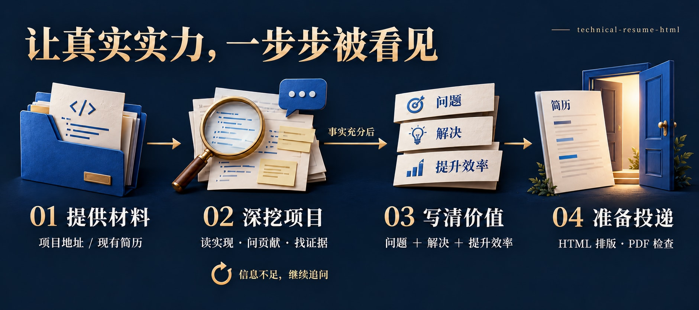
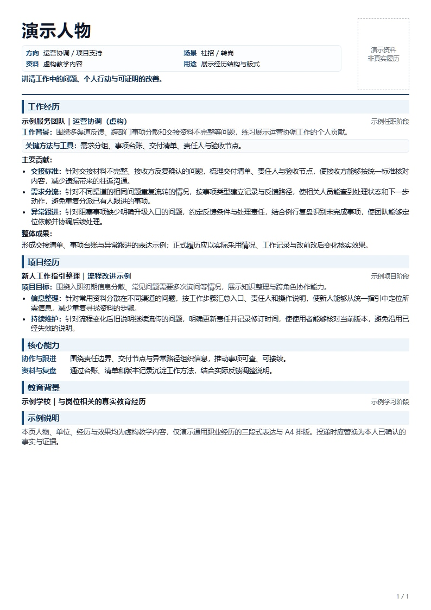

<p align="center">
  
</p>

<h1 align="center">让你的实力，被机会看见</h1>

<p align="center">
  秋招 · 校招 · 实习求职 · 项目经历深挖 · Codex Skill<br>
  <strong>先给项目地址或现有简历，多轮挖掘你的真实贡献，再把它讲给招聘者听。</strong>
</p>

<p align="center">
  <a href="#start">开始使用</a> ·
  <a href="#example">看一次具体改变</a> ·
  <a href="#workflow">它会怎么追问</a> ·
  <a href="#preview">查看输出示例</a>
</p>

找工作、找实习时，让人着急的一种情况是：你认真做过项目、排查过故障，也花时间完成了交付，投出去的介绍却只有“负责开发”“使用某某技术”。招聘者很难从中判断，你能解决什么问题。

**technical-resume-html 希望帮助真实做过事的人，把自己的价值呈现出来。** 它从项目代码或现有简历开始，持续追问个人贡献、技术选择和实际改善，再将这些信息组织成招聘者容易理解、面试时能够展开的经历。

你可以把它用于第一次找实习、秋招简历准备、课程项目梳理，或一次实习结束后的经历复盘。先把手上的材料给它，暂时不知道亮点也可以开始。

<a id="example"></a>

## 同一个技术点，怎样更容易被理解

一条简短描述：

> 使用 Redis 和数据库锁，完成接口开发。

按 **问题＋解决＋提升效率** 展开：

> 针对用户并发提交引起的编号冲突，通过切面拦截请求、Redis 幂等控制与数据库行级悲观锁进行处理，使跨表文号序号保持一致，避免重复提交导致的数据重复及提交失败。

| 招聘者想了解的事 | 条目中对应的信息 |
| --- | --- |
| 你遇到了什么具体问题？ | 并发提交引起编号冲突 |
| 你做了什么技术处理？ | 切面拦截、幂等控制、数据库行级锁 |
| 你的工作带来了什么改善？ | 文号序号一致，避免重复与提交失败 |

这段来自方法来源视频的表达示例，用于演示三段结构，**不代表使用者的真实经历，也不构成对该方案的通用技术保证**。实际写作时会逐项核实实现与效果，详见[三段式深挖说明](references/problem-solution-efficiency.md)。

“提升效率”也包括已验证的最终效果：少一次重复操作、避免一种冲突、减少人工步骤、修复一个故障。已有数据时说明基线、结果和测试范围；没有数据时继续挖掘可证明的改善。

<a id="workflow"></a>

## 从材料到一段能讲清楚的经历



**信息不足就继续追问，事实充分后才进入写作。** 可查看[完整流程定义](docs/workflow.mmd)。

例如你说“优化过并发”，它会接着问：瓶颈具体在哪里？哪些改动由你完成？原来会发生什么？改后减少了什么耗时、资源占用或失败？结果怎么验证？

**每轮通常聚焦 3—5 个关键问题，不设固定总轮数。** 已读到的信息不重复索要；关键技术点还缺“问题、解决、提升效率”中的某一段，就继续问。你也可以要求先用已知事实出草稿，再逐步补充。

| 你现在手里的材料 | 可以从这里开始 |
| --- | --- |
| 只有项目仓库，觉得亮点不明显 | 先读核心链路、测试与交付，再深挖技术选择和个人贡献 |
| 已有简历，但写成了任务清单 | 按具体技术点补齐问题、解决过程与改善 |
| 做过课程或开源复现项目 | 梳理真实复现、修改与补充验证，保留项目来源与属性 |
| 实习工作零散，不知道怎么归纳 | 从一次故障、一次需求或一条业务链路开始复盘 |
| 经历内容已有依据，需要准备投递 | 按岗位相关性组织重点，制作可编辑 HTML 与可打印版面 |

<a id="start"></a>

## 开始使用

这是供 AI 编程代理读取的 **Skill**，包含访谈与写作指令、HTML 模板和版面检查脚本。需要在支持该机制的代理中使用；不会独立运行成一个求职网站。

### 1. 安装到 Codex

下载或克隆本仓库，将包含 `SKILL.md` 的整个目录命名为 `technical-resume-html`，放入以下一个位置：

```bash
git clone https://github.com/kayaduster607-jpg/technical-resume-html.git
cd technical-resume-html
```

| 使用范围 | 目录 |
| --- | --- |
| 当前用户的项目都可使用 | `~/.agents/skills/technical-resume-html/` |
| 只在某个项目中使用 | `<项目根目录>/.agents/skills/technical-resume-html/` |

目录约定及显式调用方式依据[官方 OpenAI 文档](https://learn.chatgpt.com/docs/build-skills)。安装后若未出现，可重启 Codex；已有同名 skill 时先比较内容，避免重复安装。

<details>
<summary>Windows：从下载后的仓库根目录安装</summary>

在包含 `SKILL.md` 的目录打开 PowerShell，执行：

```powershell
# 检查当前位置，防止把无关目录当作 skill 安装。
$resumeSkillSource = (Get-Location).Path
if (-not (Test-Path -LiteralPath (Join-Path $resumeSkillSource 'SKILL.md'))) {
    throw '请先进入包含 SKILL.md 的仓库根目录。'
}

# 安装到当前用户目录；发现已有版本时停止，保留原文件。
$resumeSkillsRoot = Join-Path $env:USERPROFILE '.agents\skills'
$resumeSkillTarget = Join-Path $resumeSkillsRoot 'technical-resume-html'
if (Test-Path -LiteralPath $resumeSkillTarget) {
    throw '已有同名 skill，请先比较版本。'
}
New-Item -ItemType Directory -Path $resumeSkillsRoot -Force | Out-Null
Copy-Item -LiteralPath $resumeSkillSource -Destination $resumeSkillTarget -Recurse
```

</details>

### 2. 提供一种材料

在 Codex 中选择该 skill，或输入：

```text
使用 $technical-resume-html，帮我准备后端开发实习求职材料。

这是我的项目地址或本地路径：[填写地址或路径]
也可以先读取我附上的现有简历。

先读材料，多轮追问到能写。
每个具体技术点采用“问题＋解决＋提升效率”，
重点帮招聘者理解我实际做过什么、能解决什么问题。
```

仓库地址、本地项目和现有简历提供任意一种即可。目标岗位或 JD 已有的话一起给；材料尚不充分时，先从访谈开始。

### 3. 回答追问，再生成投递材料

写作前会区分：已有依据的事实、需要你确认的推测、没有依据的假设。个人工作与团队成果、已实现与设计方案、本机验证与生产结果分别表述。

信息充分后，生成中文经历正文和可编辑 HTML；环境支持时导出 PDF，并检查打印版面。面试证据提醒保留在简历正文之外，方便后续复习。

<a id="preview"></a>

## 输出长什么样



上图由[演示 HTML](examples/demo-resume.html)实际渲染，人物与经历均为虚构内容，用来展示栏目、技术条目和 A4 版式。可下载该文件后在浏览器打开，也可从[空白模板](assets/resume-template.html)开始。

- **正文可编辑：**原生 HTML/CSS，姓名、经历和项目都是文字。
- **打印有检查：**检查屏幕与打印模式下的溢出、页脚遮挡和图片错误，并导出 PDF。
- **版面随内容调整：**优先去重和重新分页，保留重要内容的可读性。

## 文件与工具

```text
technical-resume-html/
├── SKILL.md                         # 访谈、三段式写作与交付规则
├── README.md                        # 面向使用者的项目首页
├── agents/openai.yaml               # 技能名称和调用提示
├── assets/resume-template.html      # 可编辑的 A4 简历模板
├── references/
│   ├── problem-solution-efficiency.md
│   ├── html-layout.md
│   └── source-notes.md
├── scripts/validate_resume.cjs       # 浏览器版面检查与 PDF 导出
├── examples/demo-resume.html        # 虚构教学示例
└── docs/                            # 配图、生成记录与发布说明
```

访谈和写作由代理执行。HTML 预览只需要浏览器；自动检查另外需要 Node.js、Playwright 和可用的 Chromium 浏览器。详细运行参数见[版式与检查说明](references/html-layout.md)。

已有这些依赖时，在 skill 根目录检查一份成品：

```bash
node scripts/validate_resume.cjs path/to/resume.html --out path/to/qa
```

输出包含逐页截图、`report.json` 和 `resume.pdf`；发现问题时退出码为 `1`。脚本检查版面，事实与技术结论仍需结合原始材料核对。

## 使用时的几个约定

不会读取项目 `.env` 文件或其变体。照片预览在浏览器本地完成；代理读取简历或代码时的隐私边界取决于所用工具与账户配置，提交材料前请移除密钥、客户数据和不便分享的信息。

不编造技术、指标、职位或个人贡献。课程练习如实标注，设计方案保留实际状态。现有简历里的数字也会继续核对来源与口径。

它帮助你把已有能力表达清楚，求职结果仍取决于岗位匹配、实际能力与招聘流程。

## 一起让更多求职者被看见

如果它帮你找回了一个被忽略的项目亮点，欢迎点一个 **Star**，也欢迎把它分享给正在准备秋招或实习的朋友。

欢迎[提交 Issue](https://github.com/kayaduster607-jpg/technical-resume-html/issues)，附上脱敏后的“原始描述 → 追问过程 → 最终条目”，以及你觉得仍没挖清楚的地方。改进访谈、补充案例、优化模板和修复版面检查都很有帮助。

维护者可参考[仓库展示与检索配置](docs/github-presentation.md)。配图生成方式及提示词见[视觉记录](docs/visuals.md)，写作方法来源见[来源说明](references/source-notes.md)。
